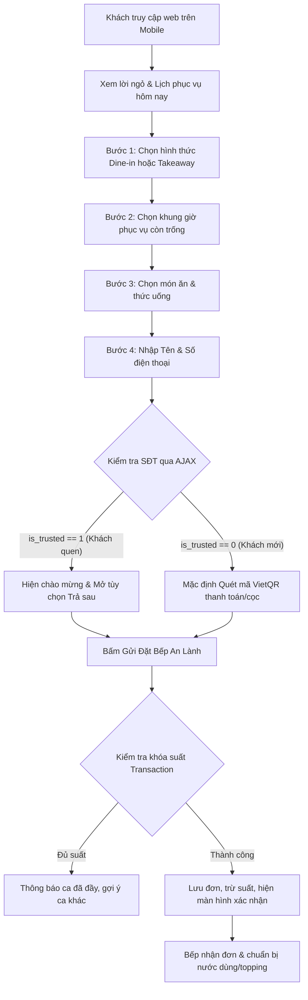

# BUSINESS_FLOW.md - Luồng Nghiệp Vụ & Quy Trình Vận Hành VeganFoodShop

Tài liệu này mô tả chi tiết các luồng nghiệp vụ thực tế, tương tác giữa các tác nhân, trạng thái chứng từ và các tình huống xử lý biên cho hệ thống **VeganFoodShop (Bếp Chay An Lành)** theo mô hình **Khung giờ & Suất ăn giới hạn (Slot & Batch Pre-order)**.

---

## 1. Các tác nhân trong hệ thống (Actors)

1. **Khách hàng (Customer):** Người dùng đặt chỗ hoặc đặt món mang về qua điện thoại di động (không cần tạo tài khoản phức tạp, chỉ cần Số điện thoại & Tên).
2. **Khách quen (Trusted Customer):** Khách hàng thân thiết đã được bếp đánh dấu `is_trusted = 1`, được hưởng đặc quyền đặt giữ chỗ trước và thanh toán sau khi dùng món hoặc nhận hàng.
3. **Chủ quán / Bếp (Admin / Kitchen Staff):** Người thiết lập lịch ca, duyệt thực đơn, theo dõi số suất nấu của từng ca và xác nhận thanh toán/đơn hàng.

---

## 2. Luồng nghiệp vụ chính (Core Business Flows)

### 2.1. Luồng Khách đặt chỗ & Đặt món (Customer Ordering Flow)
1. **Tiếp cận:** Khách truy cập vào link web đặt món (đặt tại Bio Fanpage, Zalo OA hoặc tin nhắn tự động).
2. **Xem lịch:** Khách thấy ngay thông báo ca mở bán hôm nay (ví dụ: *“Lịch bếp hôm nay: Ca trưa 11:30 - 13:30 (Còn 8 suất)”*).
3. **Chọn hình thức dùng bữa:**
   - *Ghé bếp ăn tại chỗ (`dine_in`):* Giữ bàn ăn và chỗ ngồi tại quán theo ca 45 phút.
   - *Bếp gửi ship về (`takeaway`):* Bếp đóng gói tách riêng nước dùng nóng hổi và bánh phở/rau tươi để tránh bị nát.
4. **Chọn khung giờ (Time Slots):**
   - Khách chọn 1 trong các ca còn trống chỗ (ví dụ: `11:30 - 12:15` hoặc `12:30 - 13:15`).
   - Các ca đã hết suất sẽ hiển thị nhãn *“Đã hết suất”* và bị vô hiệu hóa (disabled).
5. **Chọn món thanh tịnh:** Khách chọn số lượng từng món (Phở Nấm Hương, Bún Riêu Chay, Trà Sen Tuyết...).
6. **Nhập thông tin & Nhận diện khách quen:**
   - Khách nhập Tên và Số điện thoại.
   - Khi hoàn thành nhập số điện thoại (sự kiện `blur`), client tự động gửi request AJAX kiểm tra tới server:
     - **Nếu là Khách quen (`is_trusted == 1`):** Hệ thống hiển thị badge xanh ấm áp: *"🌿 Chào bạn quen trở lại! Bếp ghi nhận đơn ngay, bạn có thể thanh toán sau khi ghé quán nhé."* và mở thêm lựa chọn radio *"Thanh toán khi dùng bữa (Dành cho khách quen)"*.
     - **Nếu là Khách mới:** Chỉ hiển thị phương thức *"Quét mã VietQR chuyển khoản"* để tránh tình trạng bùng đơn khi bếp đã hầm xong nước dùng.
7. **Xác nhận đặt đơn:**
   - Bấm nút *"Gửi Đặt Bếp An Lành"*.
   - Hệ thống thực hiện giao dịch an toàn (Transaction `IMMEDIATE`), kiểm tra lại số suất còn lại của ca:
     - Nếu còn suất: Đơn được ghi nhận, mã đơn hàng được tạo (ví dụ `AY-20261025-001`). Màn hình hiển thị mã VietQR động (nếu chọn chuyển khoản) kèm số tiền và lời cảm ơn an lành.
     - Nếu đúng lúc đó có người khác vừa đặt hết suất: Hệ thống thông báo nhẹ nhàng và mời khách chọn sang ca kế tiếp mà không làm mất thông tin món đã chọn.

---

### 2.2. Luồng Quản trị & Vận hành Bếp (Admin & Kitchen Operations)

1. **Lên lịch theo tuần (Weekly Droplist):**
   - Vào tối Chủ nhật hoặc trước 24h-48h, chủ bếp đăng nhập trang `/admin.php`.
   - Tạo hoặc kích hoạt các ca phục vụ trong tuần (ngày, giờ bắt đầu - kết thúc, số suất tối đa `max_capacity`).
2. **Chuẩn bị nguyên liệu theo ca:**
   - Đầu mỗi ca, bếp kiểm tra màn hình danh sách đơn:
     - Tổng số suất bún, phở cần nấu.
     - Số đơn ăn tại chỗ, số đơn ship mang về.
     - Tỷ lệ món (ví dụ: 10 tô phở nấm, 5 tô bún riêu chay).
   - Nhờ biết chính xác số suất, bếp nấu nước dùng từ rau củ quả vừa đủ, thơm ngọt, không bị tồn dư lưu cữu sang ngày hôm sau.
3. **Quản lý danh sách Khách quen:**
   - Sau khi khách quen đến quán dùng bữa và tạo được sự tin cậy, chủ quán tìm SĐT của khách trong mục quản lý và bật công tắc `is_trusted = 1`.
   - Từ lần đặt tiếp theo, khách hàng này sẽ được tự động mở tính năng thanh toán sau.
4. **Xác nhận thanh toán & Trạng thái đơn:**
   - Với đơn VietQR: Khi tài khoản ngân hàng nhận được tiền, admin chuyển trạng thái sang `paid`.
   - Sau khi khách dùng món hoặc shipper lấy hàng: Admin chuyển trạng thái đơn sang `completed`.

---

## 3. Vòng đời Trạng thái Chứng từ (Status Lifecycle)

### 3.1. Trạng thái Đơn hàng (`orders.order_status`)
- `pending`: Đơn mới tạo, đang chờ khách mới thanh toán hoặc xác nhận.
- `confirmed`: Đơn đã được xác nhận (mặc định đối với khách quen trả sau hoặc khách đã quét mã).
- `completed`: Khách đã dùng bữa xong hoặc đã giao hàng thành công.
- `cancelled`: Đơn bị hủy (do khách báo bận hoặc không thanh toán cọc). Khi đơn chuyển sang `cancelled`, số suất của ca tự động được giải phóng để khách khác đặt.

### 3.2. Trạng thái Thanh toán (`orders.payment_status`)
- `pending`: Chờ khách chuyển khoản qua VietQR.
- `paid`: Đã nhận được tiền chuyển khoản thành công.
- `pay_later`: Đơn của khách quen được phép thanh toán tiền mặt/chuyển khoản trực tiếp tại quán sau khi ăn.
- `refunded`: Hoàn tiền (nếu quán có sự cố đột xuất phải hủy ca).

---

## 4. Xử lý các Tình huống Biên (Edge Cases)

| Tình huống biên | Cách xử lý trong hệ thống |
| :--- | :--- |
| **Hai khách cùng bấm đặt suất cuối cùng tại một thời điểm** | SQLite Transaction `IMMEDIATE` khóa kiểm tra capacity. Khách bấm trước được nhận đơn; khách bấm sau nhận thông báo thân thiện: *"Rất tiếc, suất cuối cùng của ca này vừa được đặt. Mời bạn chọn ca gần nhất nhé."* Dữ liệu form của khách được giữ nguyên. |
| **Khách mới không chuyển khoản cọc/thanh toán** | Sau thời gian quy định (ví dụ 15 phút trước giờ mở ca), đơn ở trạng thái `pending` chưa thanh toán có thể được admin bấm hủy (`cancelled`) để nhường suất cho khách vãng lai. |
| **Khách hủy đặt chỗ trước giờ phục vụ** | Khách gọi/nhắn tin báo bận $\rightarrow$ Admin đổi trạng thái đơn thành `cancelled`. Hệ thống lập tức cộng lại suất khả dụng cho ca đó để khách khác có thể đặt bổ sung. |
| **Bếp gặp sự cố phải đóng ca đột xuất** | Admin vào `/admin.php` tắt kích hoạt ca (`is_active = 0`). Hệ thống hiển thị danh bạ các khách đã đặt trong ca đó kèm SĐT để chủ quán chủ động gọi điện xin lỗi và dời lịch nhẹ nhàng. |
| **Khách quen đổi số điện thoại mới** | Admin vào danh mục khách hàng, tìm tên khách và cập nhật số điện thoại mới hoặc gán lại cờ `is_trusted = 1` cho số mới. |
| **Khách đặt số lượng lớn cho gia đình/nhóm** | Giới hạn mỗi đơn không được đặt vượt quá 5 suất/món để tránh một đơn chiếm hết công suất phục vụ của ca nhỏ. Nếu đi nhóm đông, form hướng dẫn khách liên hệ trực tiếp. |
